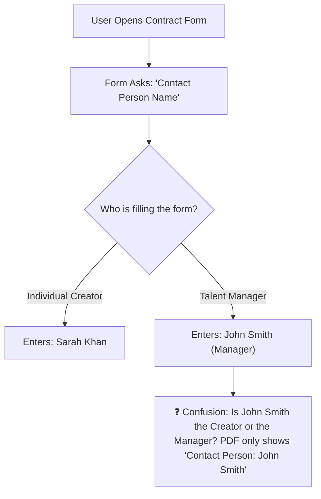
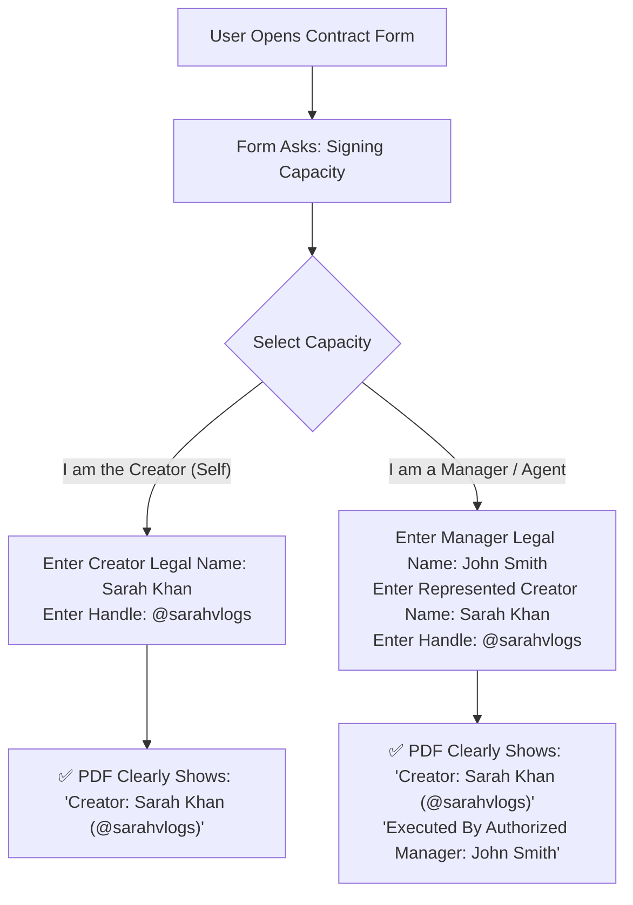

# Analysis & Diagram Guide: Creator vs. Creator Representative in All 6 Contract Workflows

This document explains the current state of party identification in all 6 contract workflows, why the current implementation creates confusion for Creators and Managers, and how adding clear **Signing Capacity** fields will solve this.

---

## 1. Overview of the Problem

In the creator economy, a contract can be signed in two distinct ways:

1. **Direct Signing (Individual Creator):** The creator signs the contract themselves (e.g., Sarah Khan signs for `@sarahvlogs`).
2. **Representative Signing (Talent Manager / Agency):** A talent manager or agency representative signs on behalf of the creator (e.g., John Smith [Manager] signs for `@sarahvlogs`).

### Current Problem
Currently, the form only asks for `"Contact Person Name"` or `"Your Full Name"`. There is no field to specify **whether the person signing is the Creator themselves or a Talent Manager/Agent signing on behalf of the Creator**.

---

## 2. Visual Diagrams

### Current Flow (Confusing)


### Proposed Clear Flow (Resolved)


---

## 3. Breakdown of All 6 Contract Types

---

### Workflow 1: `BRAND_TO_CREATOR` (Brand ➔ Creator)
- **Party 1 (Initiator):** Brand / Sponsor
- **Party 2 (Respondent):** Creator / Influencer

#### Current Condition
- **Party 1 (Brand):** Asks for Contact Person Name, Company Name, Job Title, NTN/Tax ID. *(Clear)*
- **Party 2 (Creator):** Asks for `"Contact Person Name"`, `"Instagram Handle"`, `"Capacity / Role"`.
- **Confusion:** If a Talent Manager opens Party 2's signing link, `"Contact Person Name"` is ambiguous. They don't know whether to write the Creator's name or the Manager's name.

#### What Will Be Added
- Add **Signing Capacity Selector** for Party 2:
  - `Option A: I am the Creator (Signing Myself)` ➔ Shows `Creator Legal Name`.
  - `Option B: I am a Manager / Agent (Signing for Creator)` ➔ Shows `Manager Legal Name` + `Represented Creator Name`.

---

### Workflow 2: `AGENCY_TO_CREATOR` (Agency ➔ Creator)
- **Party 1 (Initiator):** Marketing / Talent Agency
- **Party 2 (Respondent):** Creator / Influencer

#### Current Condition
- **Party 1 (Agency):** Asks for Contact Person Name, Agency Name, Job Title, NTN/Tax ID. *(Clear)*
- **Party 2 (Creator):** Asks for `"Contact Person Name"`, `"Instagram Handle"`, `"Capacity / Role"`.
- **Confusion:** Same as `BRAND_TO_CREATOR`. Agencies sending contracts to managed creators need to know if the Manager or the Creator is physically signing.

#### What Will Be Added
- Add **Signing Capacity Selector** for Party 2 (Creator / Manager option).

---

### Workflow 3: `CREATOR_TO_BRAND` (Creator ➔ Brand)
- **Party 1 (Initiator):** Creator / Influencer
- **Party 2 (Respondent):** Brand / Sponsor

#### Current Condition
- **Party 1 (Creator):** Asks for `"Your Full Name"`, `"Your Job Title"`, `"Instagram Handle"`.
- **Party 2 (Brand):** Asks for Contact Person Name, Company Name, Job Title, NTN/Tax ID. *(Clear)*
- **Confusion:** If a Talent Manager initiates a contract for one of their rostered creators, typing the Manager's name in `"Your Full Name"` hides the actual Creator's legal identity.

#### What Will Be Added
- Add **Signing Capacity Selector** for Party 1 (Initiator Creator vs. Manager).

---

### Workflow 4: `CREATOR_TO_AGENCY` (Creator ➔ Agency)
- **Party 1 (Initiator):** Creator / Influencer
- **Party 2 (Respondent):** Agency / Management Firm

#### Current Condition
- **Party 1 (Creator):** Asks for `"Your Full Name"`, `"Your Job Title"`, `"Instagram Handle"`.
- **Party 2 (Agency):** Asks for Contact Person Name, Agency Name, Job Title, NTN/Tax ID. *(Clear)*
- **Confusion:** Similar to `CREATOR_TO_BRAND`, if a Manager initiates a management agreement for a creator, Creator identity vs Manager identity is mixed.

#### What Will Be Added
- Add **Signing Capacity Selector** for Party 1.

---

### Workflow 5: `AGENCY_TO_BRAND` (Agency ➔ Brand)
- **Party 1 (Initiator):** Agency
- **Party 2 (Respondent):** Brand

#### Current Condition
- Both parties are companies/agencies. Asks for Agency/Company Name, Contact Person Name, Job Title, Tax ID.

#### Assessment
- **No Confusion.** Both parties are corporate representatives. No changes required.

---

### Workflow 6: `BRAND_TO_AGENCY` (Brand ➔ Agency)
- **Party 1 (Initiator):** Brand
- **Party 2 (Respondent):** Agency

#### Current Condition
- Both parties are companies/agencies. Asks for Company/Agency Name, Contact Person Name, Job Title, Tax ID.

#### Assessment
- **No Confusion.** Both parties are corporate representatives. No changes required.

---

## 4. Summary Table of Changes

| Contract Workflow | Current Condition | Is it Confusing? | What Will Be Added |
| :--- | :--- | :--- | :--- |
| **1. BRAND_TO_CREATOR** | Party 2 only has "Contact Person Name" | ⚠️ Yes, for Managers | Add Signing Capacity (Self vs Manager) for Party 2 |
| **2. AGENCY_TO_CREATOR** | Party 2 only has "Contact Person Name" | ⚠️ Yes, for Managers | Add Signing Capacity (Self vs Manager) for Party 2 |
| **3. CREATOR_TO_BRAND** | Party 1 only has "Your Full Name" | ⚠️ Yes, if Manager creates | Add Signing Capacity (Self vs Manager) for Party 1 |
| **4. CREATOR_TO_AGENCY** | Party 1 only has "Your Full Name" | ⚠️ Yes, if Manager creates | Add Signing Capacity (Self vs Manager) for Party 1 |
| **5. AGENCY_TO_BRAND** | Both are Business Entities | ✅ Clear | No changes needed |
| **6. BRAND_TO_AGENCY** | Both are Business Entities | ✅ Clear | No changes needed |

---

## 5. How It Will Appear on the PDF

### Before (Current)
```text
CREATOR PARTY:
Contact Person: John Smith
Handle: @sarahvlogs
```
*(Confusing: Who is John Smith? Is he the creator or the manager?)*

### After (Proposed)
```text
CREATOR PARTY:
Creator Stage Name: @sarahvlogs
Creator Legal Name: Sarah Khan
Executed By: John Smith (Authorized Talent Manager)
```
*(Clear & Legally Sound: Shows the Creator's brand and legal name, plus the Manager who signed).*
