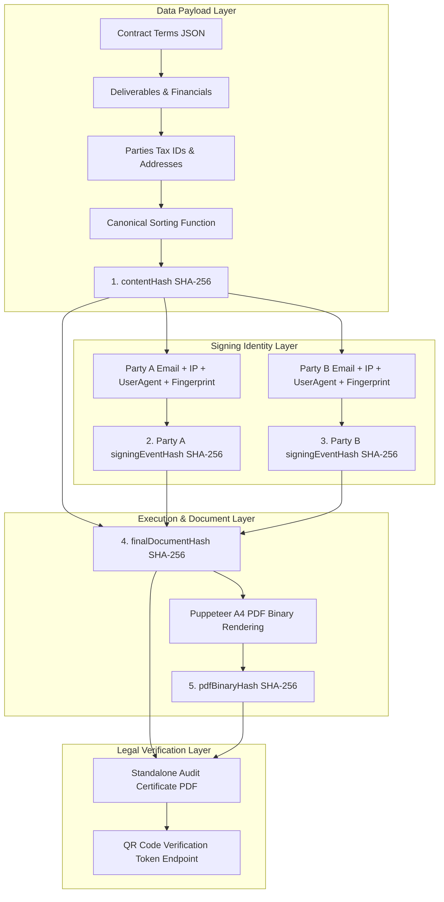

# Phase 2 Technical Implementation Plan: SignCollab Global Multi-Jurisdiction Expansion

## 1. Executive Summary & Strategic Vision

SignCollab (BrandBridge v1) is transitioning from a localized electronic contract and e-signature platform into a **Global Enterprise E-Signature & Contract Management Vault**. 

The core objective of Phase 2 is to expand the platform's operating scope to support **Simple Electronic Signatures (SES)** and **Enhanced/Advanced-Tier E-Signatures (AES-Lite)** across 25+ primary international jurisdictions spanning North America, Europe, the Middle East, Asia-Pacific, Latin America, and Africa.

The platform's existing cryptographic foundation—comprising **Email OTP 2FA Verification**, **Canvas Signature Rendering**, **IP/User-Agent/Fingerprint Logging**, **Canonical Payload SHA-256 Hashing**, **Bilateral Executed Document Hashes**, **Raw PDF Binary SHA-256 Checksums**, and **Standalone Audit Certificate PDFs with Verification QR Codes**—already exceeds the technical baseline for SES under international law. 

Phase 2 will decouple localized Pakistan-specific assumptions (such as ETO 2002, PKR currency, JazzCash/EasyPaisa, and NTN/CNIC tax IDs) and introduce a modular, data-driven **Jurisdiction & Legal Rules Engine**.

---

## 2. Platform Audit: Current State vs. Global Target Requirements

| Component | Current Implementation (Phase 1) | Target Global Architecture (Phase 2) |
| :--- | :--- | :--- |
| **Guest Contract Flow** | Limited to 2 contracts/24h per email; hardcoded PKR and Pakistan legal notices. | Global Instant Guest Contracts supporting local currencies, country selection, and localized legal notices. |
| **Registered User Flow** | Unlimited contracts; localized company/individual profiles. | Multi-currency B2B/B2C dashboards with dynamic tax IDs, company registration types, and country settings. |
| **Governing Law & E-Sign Act** | Hardcoded *Electronic Transactions Ordinance (ETO) 2002* & *Pakistan Arbitration Act 1940*. | Dynamic **Jurisdiction Engine** resolving legal frameworks for 25+ countries (ESIGN, eIDAS, UAE Decree 46, etc.). |
| **Currency & Valuation** | Hardcoded `PKR` across database, UI forms, PDF templates, and dashboard summaries. | Multi-currency support (`USD`, `EUR`, `GBP`, `AED`, `SAR`, `CAD`, `AUD`, `SGD`, `INR`, `PKR`, etc.) with symbol formatting. |
| **Payment Channels** | Enums `BANK_IBAN`, `JAZZCASH`, `EASYPAISA`. | Flexible payment methods: `BANK_IBAN`, `WIRE_TRANSFER`, `ACH_ROUTING`, `PAYPAL`, `WISE`, `SEPA`, `LOCAL_MOBILE_WALLET`. |
| **Tax & Identity IDs** | Hardcoded `NTN` (National Tax Number) and `CNIC` (National ID Card Number). | Dynamic Tax ID fields (`EIN`, `SSN`, `VAT`, `TRN`, `GSTIN`, `ABN`, `NTN`) and Generic Government ID upload routes. |
| **Tax Treatment in Contracts** | Single `totalAmount` field; no tax handling or legal liability clause. | Tax Treatment Engine: *Inclusive of Taxes*, *Exclusive of VAT/GST (+ Tax %)*, and *Cross-Border B2B Reverse Charge*. |
| **Cryptographic Evidence Vault** | 3-Hash System (`contentHash`, `signingEventHash`, `finalDocumentHash`, `pdfBinaryHash`) + Audit Logs. | Retained 100% intact, expanded with dynamic jurisdiction tags in cryptographic certificate payloads. |

---

## 3. Jurisdictional Framework & Legal Compliance Matrix (25+ Target Countries)

SignCollab Phase 2 supports the governing electronic signature statutes across all target countries under the UNCITRAL Model Law on Electronic Commerce (1996) non-discrimination principle:

```
                               ┌──────────────────────────────────────────────────┐
                               │       Global Legal Compliance Frameworks         │
                               └────────────────────────┬─────────────────────────┘
                                                        │
         ┌───────────────────────────────┬──────────────┴────────────────┬───────────────────────────────┐
         ▼                               ▼                               ▼                               ▼
  【 North America 】              【 UK & EU 】                   【 Middle East 】                 【 Asia-Pacific 】
  • USA: ESIGN Act (2000)        • UK: Elec Comm Act 2000       • UAE: Decree-Law 46/2021       • Singapore: ETA 2010
    + UETA (1999)                  & UK eIDAS Reg                 Trust Services                • Australia: ETA 1999
  • Canada: UECA & PIPEDA        • EU: eIDAS Reg 910/2014       • KSA: Royal Decree M/18        • India: IT Act 2000
                                   & eIDAS 2.0 (2024)            • Qatar, Oman, Egypt            • MY, ID, PH, TH, VN, CN
```

### Country-by-Country Legal & Tax Specification Table

| Country | Code | Primary Governing E-Signature Statute | Tax ID Label | Default Currency | Preferred Payment Methods |
| :--- | :---: | :--- | :--- | :---: | :--- |
| **United States** | `US` | ESIGN Act (2000) & UETA (1999) | EIN / SSN | `USD` ($) | ACH, Wire, PayPal, Zelle, Card |
| **United Kingdom** | `GB` | Electronic Communications Act 2000 & UK eIDAS | VAT Number | `GBP` (£) | BACS, Faster Payments, Wise, IBAN |
| **European Union (27)**| `EU` | eIDAS Regulation (EU) No 910/2014 & eIDAS 2.0 | VAT ID / NIF | `EUR` (€) | SEPA, IBAN, Wise, PayPal |
| **United Arab Emirates**| `AE` | Federal Decree-Law No. 46 of 2021 | TRN Number | `AED` (AED) | IBAN, Wire, Direct Debit |
| **Saudi Arabia** | `SA` | Electronic Transactions Law (Royal Decree M/18) | TRN / VAT | `SAR` (SAR) | IBAN, STC Pay, Wire |
| **Canada** | `CA` | Uniform Electronic Commerce Act (UECA) & PIPEDA | Business No / SIN | `CAD` ($) | Interac, EFT, Wire |
| **Australia** | `AU` | Electronic Transactions Act 1999 (Cth) | ABN / TFN | `AUD` ($) | BECS, PayID, Wire |
| **Singapore** | `SG` | Electronic Transactions Act 2010 (ETA) | UEN / NRIC | `SGD` ($) | FAST, PayNow, Wire |
| **India** | `IN` | Information Technology Act, 2000 (IT Act) | GSTIN / PAN | `INR` (₹) | UPI, NEFT/RTGS, NetBanking |
| **Pakistan** | `PK` | Electronic Transactions Ordinance (ETO), 2002 | NTN / CNIC | `PKR` (Rs) | IBAN, JazzCash, EasyPaisa |
| **Brazil** | `BR` | Provisional Measure 2.200-2/2001 & Law 14.063 | CNPJ / CPF | `BRL` (R$) | PIX, TED, Wire |
| **Mexico** | `MX` | Código de Comercio (Arts. 89–114) | RFC Number | `MXN` ($) | SPEI, Wire |
| **Colombia** | `CO` | Law 527 of 1999 & Decree 2364 of 2012 | NIT / CC | `COP` ($) | PSE, Wire |
| **Indonesia** | `ID` | Law 11/2008 on Electronic Info (ITE Law) | NPWP | `IDR` (Rp) | Bank Transfer, QRIS |
| **Malaysia** | `MY` | Electronic Commerce Act 2006 & DSA 1997 | SST / MyKad | `MYR` (RM) | DuitNow, FPX, IBAN |
| **Philippines** | `PH` | Electronic Commerce Act 2000 (RA 8792) | TIN Number | `PHP` (₱) | InstaPay, PESONet, GCash |
| **Thailand** | `TH` | Electronic Transactions Act B.E. 2544 (2001) | Tax ID No | `THB` (฿) | PromptPay, Wire |
| **Vietnam** | `VN` | Law on Electronic Transactions 2005 (Updated 2023)| MST / Citizen ID | `VND` (₫) | Bank Transfer, MoMo |
| **China** | `CN` | Electronic Signature Law of the PRC (2004/2019) | USCI / Citizen ID | `CNY` (¥) | Alipay, WeChat Pay, Wire |
| **Nigeria** | `NG` | Evidence Act 2011 & NITDA Act 2007 | TIN / NIN | `NGN` (₦) | Bank Transfer, Paystack |
| **South Africa** | `ZA` | Electronic Communications & Trans Act (ECTA) | Tax No / ID | `ZAR` (R) | EFT, Ozow, Wire |
| **Kenya** | `KE` | Kenya Information & Comm Act (KICA 2020) | KRA PIN | `KES` (KSh) | M-PESA, EFT |
| **Egypt** | `EG` | E-Signature Law No. 15 of 2004 | Tax Card No | `EGP` (EGP) | Fawry, Instapay, Wire |
| **Qatar** | `QA` | Law No. 16 of 2010 (E-Commerce Law) | QCR / QID | `QAR` (QAR) | IBAN, Local Transfer |
| **Oman** | `OM` | Electronic Transactions Law (Royal Decree 69/2008)| CR No / Civil ID | `OMR` (OMR) | IBAN, Local Transfer |
| **Ghana** | `GH` | Electronic Transactions Act, 2008 (Act 772) | TIN / Ghana Card | `GHS` (GH₵) | Mobile Money, Wire |
| **Jamaica** | `JM` | Electronic Transactions Act, 2006 | TRN Number | `JMD` ($) | Bank Transfer, Wire |

---

## 4. System Architecture & Component Diagrams

### 4.1 Global Jurisdiction & Execution Pipeline

```mermaid
flowchart TD
    A[Initiator Creates Contract] --> B{Select Jurisdiction Country}
    B -->|Country Code e.g. US, GB, AE, PK| C[Load Jurisdiction Config Rules]
    C --> D[Render Localized Form Inputs & Currency Selector]
    D --> E[Initiator OTP 2FA Verification via Resend]
    E --> F[Signature Pad Canvas Execution]
    F --> G[Generate Canonical Payload SHA-256 contentHash]
    G --> H[Create Initiator signingEventHash]
    H --> I[Save DB Contract + Send Counterparty Shared Link /c/token]
    I --> J[Counterparty Opens Shared Page]
    J --> K[Fill Counterparty Tax ID & Payment Route]
    K --> L[Counterparty OTP 2FA Verification]
    L --> M[Counterparty Signature Canvas Execution]
    M --> N[Generate Counterparty signingEventHash]
    N --> O[Compute Bilateral Executed finalDocumentHash]
    O --> P[Puppeteer Headless A4 PDF Render]
    P --> Q[Compute pdfBinaryHash Checksum]
    Q --> R[Upload Contract PDF & Audit Cert PDF to Supabase Storage]
    R --> S[Email PDF Attachments to Both Parties via Resend]
```



### 4.2 3-Hash Cryptographic Non-Repudiation Architecture



---

## 5. Database Schema & Data Model Changes (Prisma Specs)

To achieve global multi-jurisdiction capability, `prisma/schema.prisma` will be updated with new models and extended enums:

```prisma
// Extended Enums for Global Expansion

enum CurrencyCode {
  USD
  EUR
  GBP
  AED
  SAR
  CAD
  AUD
  SGD
  INR
  PKR
  BRL
  MXN
  COP
  IDR
  MYR
  PHP
  THB
  VND
  CNY
  NGN
  ZAR
  KES
  EGP
  QAR
  OMR
  GHS
  JMD
}

enum GlobalPaymentMethod {
  BANK_IBAN
  WIRE_TRANSFER
  ACH_ROUTING
  PAYPAL
  WISE
  SEPA
  LOCAL_MOBILE_WALLET
  CREDIT_DEBIT_CARD
}

enum TaxTreatmentType {
  INCLUSIVE
  EXCLUSIVE
  REVERSE_CHARGE
  EXEMPT
}

enum TaxIdType {
  EIN
  SSN
  VAT
  TRN
  GSTIN
  ABN
  NTN
  CNPJ
  CPF
  RFC
  TIN
  GENERIC_TAX_ID
}

// Global Jurisdiction Reference Table
model Jurisdiction {
  id                    String        @id @default(uuid())
  countryCode           String        @unique // e.g. "US", "GB", "AE", "PK"
  countryName           String
  governingLawName      String        // e.g. "ESIGN Act (2000) & UETA"
  lawAbbreviation       String        // e.g. "US ESIGN"
  arbitrationAct        String        // e.g. "American Arbitration Association (AAA) / Federal Arbitration Act"
  defaultCurrency       CurrencyCode  @default(USD)
  taxIdLabel            String        // e.g. "EIN / SSN"
  nationalIdLabel       String        // e.g. "Government ID"
  certificateNotice     String
  disputeResolutionClause String     @db.Text
  createdAt             DateTime      @default(now())
  updatedAt             DateTime      @updatedAt

  contracts             Contract[]

  @@map("jurisdictions")
}

// Contract Model Migration Updates
model Contract {
  // Existing fields retained...
  id                          String              @id @default(uuid())
  contractNumber              String              @unique @map("contract_number")
  
  // Phase 2 Jurisdiction Link
  jurisdictionCountryCode    String              @default("US") @map("jurisdiction_country_code")
  jurisdiction                Jurisdiction?       @relation(fields: [jurisdictionCountryCode], references: [countryCode])
  
  // Phase 2 Currency & Financial Expansion
  currency                    CurrencyCode        @default(USD)
  totalAmount                 Decimal             @map("total_amount")
  advancePayment              Decimal?            @map("advance_payment")
  remainingAmount             Decimal?            @map("remaining_amount")
  
  // Phase 2 Tax Engine
  taxTreatment                TaxTreatmentType    @default(INCLUSIVE) @map("tax_treatment")
  taxRatePct                  Decimal?            @default(0.00) @map("tax_rate_pct")
  taxAmount                   Decimal?            @default(0.00) @map("tax_amount")
  isReverseCharge             Boolean             @default(false) @map("is_reverse_charge")
  
  // Flexible Payment Methods & Dynamic Routing Details (JSON for multi-country support)
  paymentMethod               GlobalPaymentMethod? @map("payment_method")
  paymentRoutingDetails       Json?               @map("payment_routing_details") // e.g. { iban, swift, routingNo, paypalEmail, wiseTag, upiId, pixKey, mpesaNo }
  
  respondentPaymentMethod     GlobalPaymentMethod? @map("respondent_payment_method")
  respondentPaymentRoutingDetails Json?          @map("respondent_payment_routing_details")

  // Flexible Tax & Identity Fields
  initiatorTaxIdType          TaxIdType?          @map("initiator_tax_id_type")
  initiatorTaxId              String?             @map("initiator_tax_id")
  initiatorNationalId         String?             @map("initiator_national_id")
  
  respondentTaxIdType         TaxIdType?          @map("respondent_tax_id_type")
  respondentTaxId             String?             @map("respondent_tax_id")
  respondentNationalId        String?             @map("respondent_national_id")

  // High-Speed Query Performance Indexes
  @@index([paymentMethod])
  @@index([jurisdictionCountryCode])

  // ... (Hashes & signatures relationships retained)
}
```

---

## 6. Multi-Currency & Tax Engine Specifications

### 6.1 Multi-Currency Handling Engine (`src/lib/currency.ts`)

```typescript
export interface CurrencyFormatOptions {
  code: string;
  symbol: string;
  decimals?: number;
}

export const CURRENCY_MAP: Record<string, CurrencyFormatOptions> = {
  USD: { code: "USD", symbol: "$", decimals: 2 },
  EUR: { code: "EUR", symbol: "€", decimals: 2 },
  GBP: { code: "GBP", symbol: "£", decimals: 2 },
  AED: { code: "AED", symbol: "AED ", decimals: 2 },
  SAR: { code: "SAR", symbol: "SAR ", decimals: 2 },
  CAD: { code: "CAD", symbol: "CA$", decimals: 2 },
  AUD: { code: "AUD", symbol: "A$", decimals: 2 },
  SGD: { code: "SGD", symbol: "S$", decimals: 2 },
  INR: { code: "INR", symbol: "₹", decimals: 2 },
  PKR: { code: "PKR", symbol: "Rs. ", decimals: 0 },
};

export function formatCurrencyAmount(amount: number | string, currencyCode: string = "USD"): string {
  const num = Number(amount || 0);
  const info = CURRENCY_MAP[currencyCode] || { code: currencyCode, symbol: `${currencyCode} `, decimals: 2 };
  
  return `${info.symbol}${num.toLocaleString("en-US", {
    minimumFractionDigits: info.decimals,
    maximumFractionDigits: info.decimals,
  })}`;
}
```

### 6.2 Financial Tax Calculation Engine (`src/lib/tax.ts`)

```typescript
export interface TaxCalculationInput {
  totalValuation: number;
  taxTreatment: "INCLUSIVE" | "EXCLUSIVE" | "REVERSE_CHARGE" | "EXEMPT";
  taxRatePct?: number; // e.g. 20 for UK 20% VAT
}

export interface TaxCalculationResult {
  baseNetAmount: number;
  taxAmount: number;
  grossPayableAmount: number;
  displayText: string;
}

export function calculateContractTax(input: TaxCalculationInput, currencyCode: string = "USD"): TaxCalculationResult {
  const total = Number(input.totalValuation || 0);
  const rate = Number(input.taxRatePct || 0) / 100;

  if (input.taxTreatment === "EXCLUSIVE" && rate > 0) {
    const tax = total * rate;
    const gross = total + tax;
    return {
      baseNetAmount: total,
      taxAmount: tax,
      grossPayableAmount: gross,
      displayText: `${formatCurrencyAmount(total, currencyCode)} + ${input.taxRatePct}% Tax (${formatCurrencyAmount(tax, currencyCode)}) = Total: ${formatCurrencyAmount(gross, currencyCode)}`,
    };
  }

  if (input.taxTreatment === "INCLUSIVE" && rate > 0) {
    const base = total / (1 + rate);
    const tax = total - base;
    return {
      baseNetAmount: base,
      taxAmount: tax,
      grossPayableAmount: total,
      displayText: `${formatCurrencyAmount(total, currencyCode)} (Inclusive of ${input.taxRatePct}% Tax / ${formatCurrencyAmount(tax, currencyCode)})`,
    };
  }

  if (input.taxTreatment === "REVERSE_CHARGE") {
    return {
      baseNetAmount: total,
      taxAmount: 0,
      grossPayableAmount: total,
      displayText: `${formatCurrencyAmount(total, currencyCode)} (Cross-Border B2B Reverse Charge - No Tax Charged)`,
    };
  }

  return {
    baseNetAmount: total,
    taxAmount: 0,
    grossPayableAmount: total,
    displayText: `${formatCurrencyAmount(total, currencyCode)} (Tax Exempt / Inclusive)`,
  };
}
```

---

## 7. Global Jurisdiction Configuration Engine (`src/lib/config/jurisdictions.ts`)

This central engine provides legal text, tax labels, and arbitration clauses for all 25+ target countries:

```typescript
export interface JurisdictionDefinition {
  countryCode: string;
  countryName: string;
  governingLawName: string;
  lawAbbreviation: string;
  arbitrationAct: string;
  defaultCurrency: string;
  taxIdLabel: string;
  nationalIdLabel: string;
  disputeClause: string;
  certificateLegalNotice: string;
}

export const JURISDICTIONS: Record<string, JurisdictionDefinition> = {
  US: {
    countryCode: "US",
    countryName: "United States",
    governingLawName: "Electronic Signatures in Global and National Commerce Act (ESIGN 2000) & UETA",
    lawAbbreviation: "US ESIGN & UETA",
    arbitrationAct: "Federal Arbitration Act (FAA) & AAA Commercial Arbitration Rules",
    defaultCurrency: "USD",
    taxIdLabel: "EIN / Tax ID",
    nationalIdLabel: "SSN / State ID",
    disputeClause: "This Agreement shall be governed by the laws of the State of Delaware, United States, without regard to conflict of law principles. Any dispute exceeding $25,000 USD shall be settled by binding arbitration administered by the American Arbitration Association (AAA).",
    certificateLegalNotice: "Executed under US Federal ESIGN Act (15 U.S.C. § 7001) and Uniform Electronic Transactions Act (UETA) guidelines.",
  },
  GB: {
    countryCode: "GB",
    countryName: "United Kingdom",
    governingLawName: "Electronic Communications Act 2000 & UK eIDAS Regulations",
    lawAbbreviation: "UK eIDAS",
    arbitrationAct: "Arbitration Act 1996 of the United Kingdom",
    defaultCurrency: "GBP",
    taxIdLabel: "VAT Registration No",
    nationalIdLabel: "National Insurance No",
    disputeClause: "This Agreement shall be governed by and construed in accordance with the laws of England and Wales. The courts of England and Wales shall have exclusive jurisdiction to settle any dispute.",
    certificateLegalNotice: "Executed under UK Electronic Communications Act 2000 and UK eIDAS Regulation standards.",
  },
  AE: {
    countryCode: "AE",
    countryName: "United Arab Emirates",
    governingLawName: "Federal Decree-Law No. 46 of 2021 on Electronic Transactions and Trust Services",
    lawAbbreviation: "UAE Decree-Law 46/2021",
    arbitrationAct: "DIAC (Dubai International Arbitration Centre) Rules",
    defaultCurrency: "AED",
    taxIdLabel: "TRN (Tax Reg Number)",
    nationalIdLabel: "Emirates ID (EID)",
    disputeClause: "This Agreement is governed by the laws of the United Arab Emirates as applied in the Emirate of Dubai. Disputes shall be finally settled under the Arbitration Rules of DIAC.",
    certificateLegalNotice: "Executed under UAE Federal Decree-Law No. 46 of 2021 on Electronic Transactions and Trust Services.",
  },
  EU: {
    countryCode: "EU",
    countryName: "European Union",
    governingLawName: "eIDAS Regulation (EU) No 910/2014 & eIDAS 2.0 (EU 2024/1183)",
    lawAbbreviation: "EU eIDAS Reg 910/2014",
    arbitrationAct: "ICC Rules of Arbitration",
    defaultCurrency: "EUR",
    taxIdLabel: "VAT ID / NIF",
    nationalIdLabel: "National ID / Passport",
    disputeClause: "This Agreement is governed by EU contract directives and local law of the Initiator. Article 25(1) eIDAS non-discrimination applies to electronic execution.",
    certificateLegalNotice: "Executed under European Union eIDAS Regulation (EU) No 910/2014 Article 25(1).",
  },
  IN: {
    countryCode: "IN",
    countryName: "India",
    governingLawName: "Information Technology Act, 2000 & Section 63 of Bharatiya Sakshya Adhiniyam (BSA) 2023",
    lawAbbreviation: "India IT Act & BSA",
    arbitrationAct: "Arbitration and Conciliation Act, 1996 of India",
    defaultCurrency: "INR",
    taxIdLabel: "GSTIN / PAN Number",
    nationalIdLabel: "Government ID (Optional)",
    disputeClause: "This Agreement shall be governed by the laws of India. Any dispute arising out of this agreement shall be referred to final and binding arbitration under the Arbitration and Conciliation Act, 1996.",
    certificateLegalNotice: "Cryptographic audit record formatted in compliance with Section 63 of the Bharatiya Sakshya Adhiniyam, 2023.",
  },
  PK: {
    countryCode: "PK",
    countryName: "Pakistan",
    governingLawName: "Electronic Transactions Ordinance (ETO), 2002",
    lawAbbreviation: "ETO 2002",
    arbitrationAct: "Arbitration Act 1940 of Pakistan",
    defaultCurrency: "PKR",
    taxIdLabel: "NTN (National Tax No)",
    nationalIdLabel: "CNIC Number",
    disputeClause: "This Agreement is governed by the laws of the Islamic Republic of Pakistan. Claims exceeding PKR 500,000 shall proceed to binding arbitration under the Arbitration Act 1940.",
    certificateLegalNotice: "Executed under Pakistan Electronic Transactions Ordinance (ETO 2002) guidelines.",
  },
};

export function getJurisdiction(code: string = "US"): JurisdictionDefinition {
  return JURISDICTIONS[code.toUpperCase()] || JURISDICTIONS["US"];
}
```

---

## 8. Dynamic Contract & Certificate PDF Engine Specs

### 8.1 Refactored Contract PDF Generator (`src/lib/pdf/generate.ts`)

```typescript
// Segment of refactored generate.ts displaying dynamic global headers and sections

const jur = getJurisdiction(contract.jurisdictionCountryCode || "US");
const currCode = contract.currency || jur.defaultCurrency;
const taxInfo = calculateContractTax({
  totalValuation: Number(contract.totalAmount),
  taxTreatment: contract.taxTreatment as any,
  taxRatePct: Number(contract.taxRatePct || 0),
}, currCode);

// Dynamic Header Title
const headerRightHtml = `
  <div style="font-size: 9.5pt; font-weight: 800; color: #0f172a; text-transform: uppercase;">${getContractTitle(contract.contractType)}</div>
  <div style="font-size: 7.2pt; color: #64748b; margin-top: 2px;">
    Ref No: <strong style="color: #2563eb;">${contract.contractNumber}</strong> | Created: ${formatLegalDate(contract.createdAt)} | ${jur.lawAbbreviation} Compliant
  </div>
`;

// Dynamic Section 1: Tax IDs
const partyATaxHtml = contract.initiatorTaxId ? `<div style="font-size: 8pt; color: #475569; font-weight: bold; margin-bottom: 4px;">${jur.taxIdLabel}: ${contract.initiatorTaxId}</div>` : "";
const partyBTaxHtml = contract.respondentTaxId ? `<div style="font-size: 8pt; color: #475569; font-weight: bold; margin-bottom: 4px;">${jur.taxIdLabel}: ${contract.respondentTaxId}</div>` : "";

// Dynamic Section 4: Multi-Currency & Financials
const financialsTableHtml = `
  <table style="width: 100%; border-collapse: collapse; margin-bottom: 14px; font-size: 8.5pt; border: 1px solid #cbd5e1;">
    <thead>
      <tr style="background-color: #f1f5f9; color: #0f172a; text-transform: uppercase; font-size: 8pt;">
        <th style="padding: 6px 8px; border: 1px solid #cbd5e1; text-align: left;">Total Campaign Valuation</th>
        <th style="padding: 6px 8px; border: 1px solid #cbd5e1; text-align: left;">Tax Terms &amp; Treatment</th>
        <th style="padding: 6px 8px; border: 1px solid #cbd5e1; text-align: left;">Advance Payout</th>
        <th style="padding: 6px 8px; border: 1px solid #cbd5e1; text-align: left;">Remaining Payout</th>
      </tr>
    </thead>
    <tbody>
      <tr>
        <td style="padding: 6px 8px; border: 1px solid #cbd5e1; font-weight: bold; font-size: 9.5pt;">${formatCurrencyAmount(contract.totalAmount, currCode)}</td>
        <td style="padding: 6px 8px; border: 1px solid #cbd5e1;">${taxInfo.displayText}</td>
        <td style="padding: 6px 8px; border: 1px solid #cbd5e1;"><strong>${formatCurrencyAmount(contract.advancePayment || 0, currCode)}</strong></td>
        <td style="padding: 6px 8px; border: 1px solid #cbd5e1;"><strong>${formatCurrencyAmount(getRemainingAmount(), currCode)}</strong></td>
      </tr>
    </tbody>
  </table>
`;

// Dynamic Section 11: Governing Law & Jurisdiction
const disputeSectionHtml = `
  <div style="font-size: 10pt; font-weight: 800; text-transform: uppercase; color: #0f172a; border-bottom: 1.5px solid #0f172a; padding-bottom: 3px; margin-top: 14px; margin-bottom: 8px;">
    11. GOVERNING LAW &amp; DISPUTE RESOLUTION (ADR)
  </div>
  <div style="border: 1px solid #cbd5e1; border-radius: 6px; padding: 10px; font-size: 8.5pt; margin-bottom: 14px; background: #ffffff; line-height: 1.6;">
    ${jur.disputeClause} Legal recourse and dispute determination shall be administered under the <strong>${jur.arbitrationAct}</strong>.
  </div>
`;

// Dynamic Section 12: Signature Log
const sigSectionHeaderHtml = `
  <div style="font-size: 10pt; font-weight: 800; text-transform: uppercase; color: #0f172a; border-bottom: 1.5px solid #0f172a; padding-bottom: 3px; margin-top: 14px; margin-bottom: 8px;">
    12. ${jur.lawAbbreviation.toUpperCase()} BILATERAL SIGNATURE AUDIT LOG &amp; CRYPTOGRAPHIC VERIFICATION
  </div>
`;
```

---

### 8.2 Refactored Audit Certificate PDF Generator (`src/lib/pdf/generateCertificate.ts`)

```typescript
const jur = getJurisdiction(contract.jurisdictionCountryCode || "US");

// Dynamic Audit Certificate Header Subtitle
const certSubtitleHtml = `
  <p style="margin: 2px 0 0 0; font-size: 8.5pt; color: #475569;">
    Cryptographic Audit Trail &amp; ${jur.lawAbbreviation} Proof of Execution
  </p>
`;

// Dynamic Section 1 Signer Identity Cards
const partyATaxLine = contract.initiatorTaxId ? `<div style="font-size: 8pt; color: #475569; font-weight: bold; margin-bottom: 4px;">${jur.taxIdLabel}: ${contract.initiatorTaxId}</div>` : "";
const partyBTaxLine = contract.respondentTaxId ? `<div style="font-size: 8pt; color: #475569; font-weight: bold; margin-bottom: 4px;">${jur.taxIdLabel}: ${contract.respondentTaxId}</div>` : "";

// Dynamic Legal Vault Footer Notice
const footerNoticeHtml = `
  <div style="font-size: 6.8pt; line-height: 1.35; color: #64748b; max-width: 95%; margin: 0 auto 4px auto;">
    LEGAL STANDING &amp; ADMISSIBILITY DISCLAIMER: SignCollab provides digital document creation and cryptographic signature logging in compliance with ${jur.governingLawName}. SignCollab is an independent technology provider, not a law firm, and disclaims liability arising from enforcement of contract terms.
  </div>
`;
```

---

## 9. Frontend Component & Modal Refactoring

### 9.1 Dynamic `SignaturePadModal.tsx`

```tsx
interface SignaturePadModalProps {
  isOpen: boolean;
  onClose: () => void;
  onConfirm: (signatureB64: string, fingerprint: string) => void;
  loading?: boolean;
  countryCode?: string; // Phase 2 Global Addition
}

export const SignaturePadModal: React.FC<SignaturePadModalProps> = ({
  isOpen, onClose, onConfirm, loading = false, countryCode = "US"
}) => {
  const jur = getJurisdiction(countryCode);

  return (
    <div className="fixed inset-0 z-50 flex items-center justify-center p-4">
      {/* Modal Container */}
      <div className="bg-white max-w-2xl w-full rounded-3xl p-6 shadow-2xl">
        <h3 className="text-base font-black uppercase">Execute Digital Signature</h3>
        
        {/* Dynamic Legal Consent Warning */}
        <div className="p-3.5 rounded-2xl bg-blue-50 border border-blue-200 text-xs text-blue-900 mt-3">
          <strong>Legal Consent:</strong> By checking the box below and drawing your signature, you confirm your consent to enter into a legally binding electronic agreement governed by <strong>{jur.governingLawName}</strong> and SignCollab&apos;s Terms of Service.
        </div>
        
        {/* Canvas & Actions... */}
      </div>
    </div>
  );
};
```

### 9.2 Country & Currency Selector UI Pattern

```tsx
// Location: Contract Creation Wizards (/instant & /dashboard/contracts/new)

<div className="grid grid-cols-1 md:grid-cols-2 gap-4">
  {/* Country Jurisdiction Selector */}
  <div>
    <label className="block text-xs font-bold uppercase text-gray-700 mb-1">
      Governing Country Jurisdiction
    </label>
    <select
      value={jurisdictionCountryCode}
      onChange={(e) => {
        setJurisdictionCountryCode(e.target.value);
        const jur = getJurisdiction(e.target.value);
        setCurrency(jur.defaultCurrency); // Auto-update currency default
      }}
      className="w-full p-3 border border-gray-300 rounded-xl font-medium text-sm"
    >
      {Object.values(JURISDICTIONS).map((j) => (
        <option key={j.countryCode} value={j.countryCode}>
          {j.countryName} ({j.lawAbbreviation})
        </option>
      ))}
    </select>
  </div>

  {/* Currency Selector */}
  <div>
    <label className="block text-xs font-bold uppercase text-gray-700 mb-1">
      Contract Valuation Currency
    </label>
    <select
      value={currency}
      onChange={(e) => setCurrency(e.target.value)}
      className="w-full p-3 border border-gray-300 rounded-xl font-medium text-sm"
    >
      {Object.keys(CURRENCY_MAP).map((code) => (
        <option key={code} value={code}>
          {code} ({CURRENCY_MAP[code].symbol})
        </option>
      ))}
    </select>
  </div>
</div>
```

---

## 10. API Route Specifications & Payload Migrations

### 10.1 `POST /api/guest/contracts` (Instant Contract API)

Update endpoint to accept global parameters while preserving guest 24-hr rate limiting:

```typescript
// Incoming Payload Expansion
const {
  contractType,
  jurisdictionCountryCode = "US",
  currency = "USD",
  taxTreatment = "INCLUSIVE",
  taxRatePct = 0,
  initiatorName,
  initiatorEmail,
  initiatorTaxId,      // Generic tax ID (replacing hardcoded NTN)
  initiatorNationalId, // Generic ID (replacing hardcoded CNIC)
  totalAmount,
  advancePayment,
  paymentMethod,       // Enum: BANK_IBAN, WIRE_TRANSFER, PAYPAL, etc.
  bankAccountIban,
  bankRoutingNumber,
  bankSwiftBic,
  paypalEmail,
  // ... deliverables & terms
} = await req.json();
```

### 10.2 `POST /api/contracts/share/[token]/sign` (Respondent Sign API)

To guarantee that Party A's initial `signingEventHash` remains 100% valid and mathematically uncorrupted, the API adopts **Approach A (The Immutable Base ContentHash Model)**:
- The base `contract.contentHash` generated at contract draft/submission is frozen and remains immutable.
- Respondent's identity details (`taxId`, `nationalId`, `paymentRoutingDetails`) are persisted to the database and bound into Respondent's distinct `signingEventHash`.
- Party A's original `signingEventHash` remains untouched, preventing signature mutation.

```typescript
// Extract respondent tax & payment details
const {
  signatureB64,
  email,
  name,
  taxId,         // Generic Respondent Tax ID (e.g. VAT, TRN, EIN)
  nationalId,    // Generic Respondent National ID
  paymentMethod, // Global payment method selection
  paymentRoutingDetails, // JSON payment routing object
  fingerprint,
} = body;

// 1. Retrieve the immutable base contentHash created during draft/submission
const baseContentHash = contract.contentHash; 

// 2. Stringify payment routing details to cryptographically bind payout account to signature
const routingString = JSON.stringify(paymentRoutingDetails || {});

// 3. Compute Respondent's immutable Signing Event Hash (incorporating identity + payout account)
const respondentSigningEventHash = crypto.createHash("sha256")
  .update(`${baseContentHash}-${cleanEmail}-${taxId || ""}-${routingString}-${ipAddress}-${userAgent}-${fingerprint || ""}`)
  .digest("hex");

// 4. Compute Bilateral Executed Hash combining both un-mutated event hashes
const initiatorSigningEventHash = initiatorSig?.signingEventHash || "PRE_SIGNED";

const finalDocumentHash = crypto.createHash("sha256")
  .update(`${baseContentHash}-${initiatorSigningEventHash}-${respondentSigningEventHash}`)
  .digest("hex");
```

---

## 11. Security, Cryptographic Integrity & Storage Infrastructure

### 11.1 Supabase Storage Directory Structure

Phase 2 will maintain structured Supabase Storage buckets under `profiles`:

```
profiles/
├── agreements/
│   ├── [contractId].pdf              <-- Primary Bilateral Executed Contract PDF
│   └── drafts/[contractId]_draft.pdf
└── certificates/
    └── [contractId]_certificate.pdf  <-- Standalone Cryptographic Audit Certificate PDF
```

### 11.2 Verification Token Validation (`/api/contracts/verify`)

Public verification endpoint `/api/contracts/verify?token=[verifyToken]` returns structured legal verification response:

```json
{
  "verified": true,
  "contractNumber": "BB-US-582910-4821",
  "status": "ACTIVE",
  "jurisdiction": {
    "country": "United States",
    "law": "Electronic Signatures in Global and National Commerce Act (ESIGN 2000) & UETA",
    "arbitration": "Federal Arbitration Act (FAA)"
  },
  "hashes": {
    "finalDocumentHash": "e3b0c44298fc1c149afbf4c8996fb92427ae41e4649b934ca495991b7852b855",
    "pdfBinaryHash": "7f83b1657ff1fc53b92dc18148a1d65dfc2d4b1fa3d677284ddd200126d9069"
  },
  "signers": [
    { "role": "Party A (Initiator)", "email": "brand@company.com", "otpVerified": true, "signedAt": "2026-07-18T10:00:00Z" },
    { "role": "Party B (Respondent)", "email": "creator@agency.com", "otpVerified": true, "signedAt": "2026-07-18T10:05:00Z" }
  ]
}
```

---

## 12. Phase 2 Step-by-Step Implementation Roadmap

```
Phase 2 Global Rollout Roadmap:
===============================

[ Milestone 1: Database & Core Config Engine ]
  ├─ 1.1 Update prisma/schema.prisma with Jurisdiction, Currency, and Tax enums
  ├─ 1.2 Run Prisma migrations (`npx prisma migrate dev`)
  ├─ 1.3 Create src/lib/config/jurisdictions.ts with 25+ country definitions
  ├─ 1.4 Create src/lib/currency.ts and src/lib/tax.ts engines
  └─ 1.5 Seed database with default Jurisdiction records

[ Milestone 2: PDF Template & Renderer Refactoring ]
  ├─ 2.1 Update src/lib/pdf/generate.ts to use dynamic currency, tax, and law strings
  ├─ 2.2 Update src/lib/pdf/generateCertificate.ts to render dynamic audit notices & QR
  └─ 2.3 Unit test Puppeteer PDF rendering for US, UK, EU, UAE, and PK jurisdictions

[ Milestone 3: API Controller & Logic Updates ]
  ├─ 3.1 Update POST /api/guest/contracts to handle global payloads
  ├─ 3.2 Update POST /api/contracts/[id]/submit for registered user global submission
  ├─ 3.3 Update POST /api/contracts/share/[token]/sign for global counterparty execution
  └─ 3.4 Update GET /api/contracts/verify for dynamic verification metadata

[ Milestone 4: Frontend UI/UX Refactoring ]
  ├─ 4.1 Update SignaturePadModal.tsx to accept dynamic countryCode prop
  ├─ 4.2 Add Jurisdiction & Currency selectors to /instant and /dashboard/contracts/new
  ├─ 4.3 Update /c/[token] shared signing page for global payment methods & tax IDs
  └─ 4.4 Update /profile settings to support international tax numbers & currencies

[ Milestone 5: Quality Assurance & Launch ]
  ├─ 5.1 End-to-end testing of Instant Contract flow across 5 test currencies (USD, EUR, GBP, AED, PKR)
  ├─ 5.2 Validate PDF binary hashes and QR code verification links
  └─ 5.3 Deploy Phase 2 Global E-Signature Vault to Production
```

---

### Verification and Feedback

This plan covers every aspect of transforming SignCollab into a global e-signature platform. Please review the proposed changes and let me know if you would like to proceed with implementation or make adjustments to any section.
